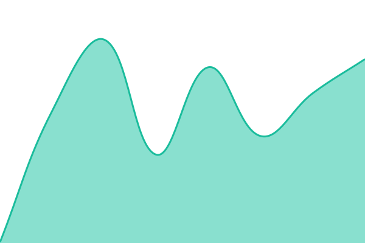

# [📈 Live Status](https://wsbelijah.github.io/status): <!--live status--> **🟩 All systems operational**

This repository contains the open-source uptime monitor and status page for [wsbelijah](https://wsbelijah.github.io/status), powered by [Upptime](https://github.com/upptime/upptime).

With [Upptime](https://upptime.js.org), you can get your own unlimited and free uptime monitor and status page, powered entirely by a GitHub repository. We use [Issues](https://github.com/wsbelijah/status/issues) as incident reports, [Actions](https://github.com/wsbelijah/status/actions) as uptime monitors, and [Pages](https://wsbelijah.github.io/status) for the status page.

<!--start: status pages-->
<!-- This summary is generated by Upptime (https://github.com/upptime/upptime) -->
<!-- Do not edit this manually, your changes will be overwritten -->
<!-- prettier-ignore -->
| URL | Status | History | Response Time | Uptime |
| --- | ------ | ------- | ------------- | ------ |
|  [AMPED UP AUDIO](https://ampedup-audio.com) | 🟩 Up | [amped-up-audio.yml](https://github.com/wsbelijah/status/commits/HEAD/history/amped-up-audio.yml) | 

 207ms
     
 | 

<a href="https://wsbelijah.github.io/status/history/amped-up-audio">100.00%</a>
    

|  [Garcia's Wheels & Tires](https://garciaswheelsandtire.com) | 🟩 Up | [garcia-s-wheels-and-tires.yml](https://github.com/wsbelijah/status/commits/HEAD/history/garcia-s-wheels-and-tires.yml) | 

 208ms
     
 | 

<a href="https://wsbelijah.github.io/status/history/garcia-s-wheels-and-tires">100.00%</a>
    

|  [That's So Cee Salon](https://thats-so-cee.pages.dev) | 🟩 Up | [that-s-so-cee-salon.yml](https://github.com/wsbelijah/status/commits/HEAD/history/that-s-so-cee-salon.yml) | 

 165ms
     
 | 

<a href="https://wsbelijah.github.io/status/history/that-s-so-cee-salon">100.00%</a>
    

|  [Lucca Fracassi](https://lucca-fracassi.pages.dev) | 🟩 Up | [lucca-fracassi.yml](https://github.com/wsbelijah/status/commits/HEAD/history/lucca-fracassi.yml) | 

 152ms
     
 | 

<a href="https://wsbelijah.github.io/status/history/lucca-fracassi">100.00%</a>
    

<!--end: status pages-->

[**Visit our status website →**](https://wsbelijah.github.io/status)

## 📄 License

- Powered by: [Upptime](https://github.com/upptime/upptime)
- Code: [MIT](./LICENSE) © [Anand Chowdhary](https://anandchowdhary.com)
- Data in the `./history` directory: [Open Database License](https://opendatacommons.org/licenses/odbl/1-0/)
